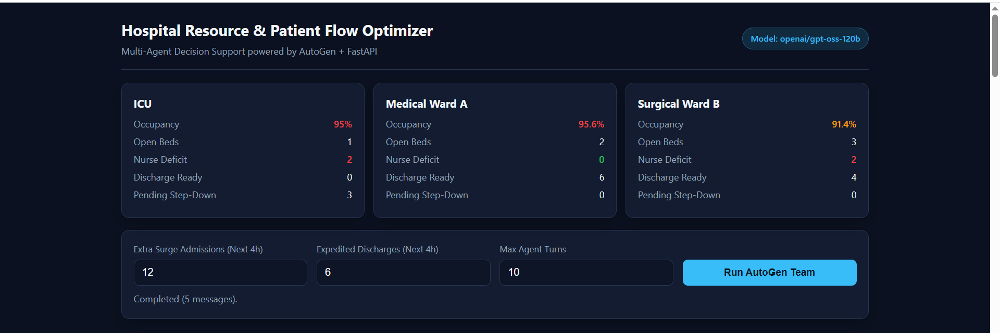
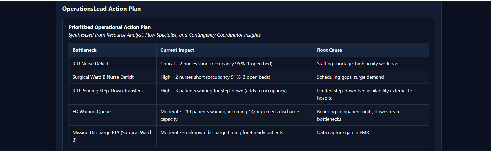
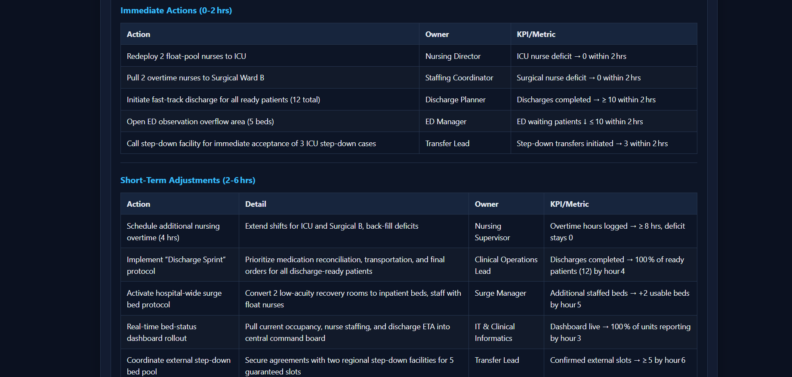
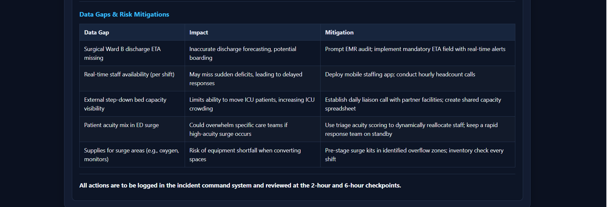
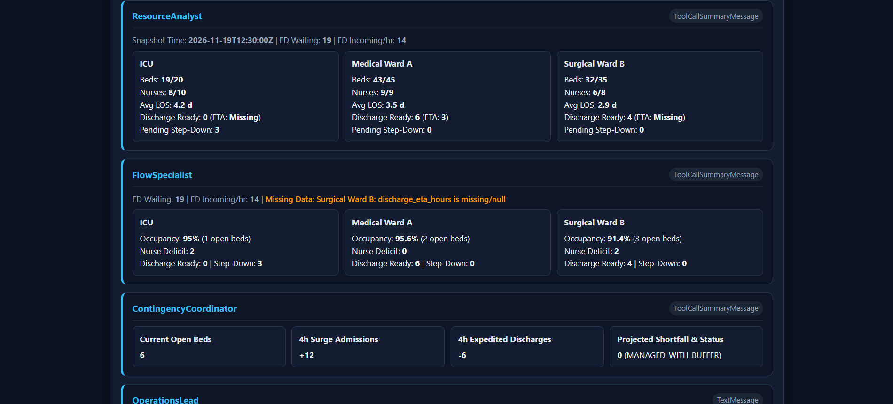
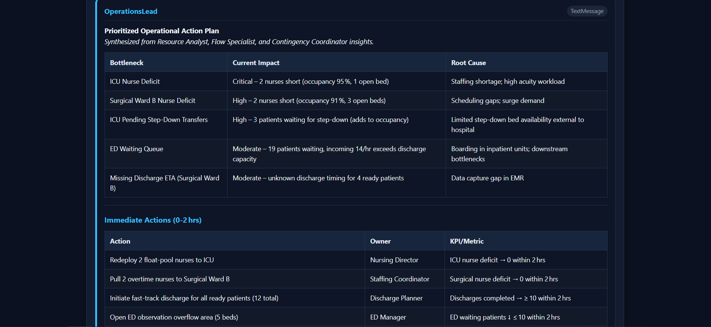
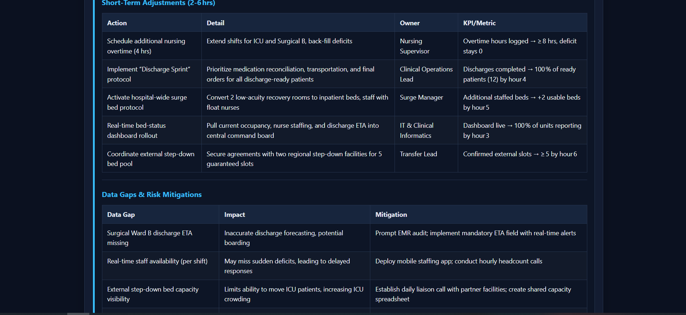

# Hospital Resource & Patient Flow Optimization (AutoGen + FastAPI)

Multi-agent decision-support system built with **AutoGen AgentChat**, **FastAPI**, and **Groq** to analyze hospital bed occupancy, nursing staffing gaps, ED queue/boarding pressure, missing operational data, and 4-hour admission surges.

**Repository:** [https://github.com/rabia537193-gif/hospital-flow-autogen](https://github.com/rabia537193-gif/hospital-flow-autogen)

## 🎥 Demo Video
- **[Watch Full Walkthrough & Live Demo on Google Drive](https://drive.google.com/file/d/1cgVezc9SNgmzaNN3BshPrSi6uB0HD1bb/view?usp=sharing)**

---

## 🧩 Multi-Agent Architecture
- **ResourceAnalyst**: Loads the hospital snapshot and computes unit-level bed occupancy, open beds, and nurse staffing deficits.
- **FlowSpecialist**: Identifies ED boarding pressure, ICU step-down delays, and discharge bottlenecks.
- **ContingencyCoordinator**: Flags missing/null fields (`discharge_eta_hours` in Surgical Ward B) and runs 4-hour admission surge simulations.
- **OperationsLead**: Synthesizes all specialist outputs into a prioritized operational action plan (`0–2 hrs` immediate actions, `2–6 hrs` short-term adjustments, and risk mitigations).

---

## 📸 Application Screenshots

### 1. Live Unit Dashboard & Surge Controls


### 2. OperationsLead — Top Bottlenecks Analysis


### 3. Immediate Actions (0–2 hrs) & Short-Term Adjustments (2–6 hrs)


### 4. Data Gaps & Risk Mitigations


### 5. Multi-Agent Tool Execution Trace (ResourceAnalyst, FlowSpecialist, ContingencyCoordinator)


### 6. OperationsLead Trace — Bottlenecks & Immediate Actions


### 7. OperationsLead Trace — Short-Term Adjustments & Mitigations


---

## ⚙️ Setup & Run

1. **Clone the repository**
   ```bash
   git clone [https://github.com/rabia537193-gif/hospital-flow-autogen.git](https://github.com/rabia537193-gif/hospital-flow-autogen.git)
   cd hospital-flow-autogen

2. **Create and activate a virtual environment**

Bash
python -m venv .venv
# Windows:
.venv\Scripts\activate
# macOS/Linux:
source .venv/bin/activate
3. **Install dependencies**

Bash
pip install -r requirements.txt
pip install fastapi uvicorn

4. **Configure environment variables**
Copy .env.example to .env and add your GROQ_API_KEY:

Code snippet
GROQ_API_KEY=your_groq_api_key_here
GROQ_BASE_URL=[https://api.groq.com/openai/v1](https://api.groq.com/openai/v1)
GROQ_MODEL=openai/gpt-oss-120b

5. **Run the FastAPI Web UI or CLI**

Bash
uvicorn api:app --reload
# Open [http://127.0.0.1:8000](http://127.0.0.1:8000) in your browser

# Or run CLI mode:
python app.py

---

### GitHub Par Push Karne Ki Commands

PowerShell mein `hospital-flow-autogen` folder ke andar yeh commands chala dein:

```powershell
git add README.md images/
git commit -m "Update README with repo link, demo video, and UI screenshots"
git push -u origin main